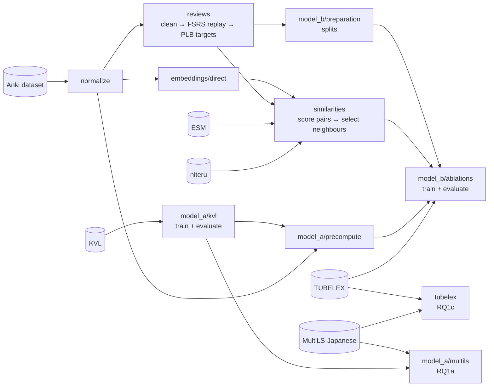

# Predicting Personalized Vocabulary Learning Burden from Intralexical and Interlexical Factors

This repository contains the source code accompanying the paper **"Predicting Personalized Vocabulary Learning Burden from Intralexical and Interlexical Factors"** by Mykhailo Diachenko and John P. McCrae, submitted to NLP4CALL 2026.

The Anki dataset collected for this study is available on [Hugging Face](https://huggingface.co/datasets/nekear/anki-language-learning). The pipeline additionally uses five third-party resources, described in [Data](#data).

> **Reproducibility**. Running the pipeline on the public release produces slightly different results from those reported in the paper. To protect participants' privacy, 
> we shifted each learner's timestamps by a different random offset, and replaced all identifiers. As a result, this changes the order in which records are processed during training.
> The data splits and median baselines remain identical, while the learned models (GBDT and SetTransformer) typically differ by less than 0.015 in Spearman ρ, with a maximum difference of 0.08 for L03.
> 
> That said, the paper's main findings remain unchanged, while a few small effects, already described in the paper as slight or borderline, cross the significance threshold. These effects correspond to at most 3.8 percentage points of error reduction, with confidence bounds coming within roughly 1 point of zero. For example, the borderline benefit of censored neighbours for L02 is no longer statistically significant. The changes are small, at most 1.6 percentage points, and are consistent with the variation expected from a different training order.

### Research questions

The project asks two research questions:
- RQ1: How much of PLB can population-level features explain?
  - RQ1a: Does the productive difficulty prior transfer to receptive population-level difficulty?
  - RQ1b: What share of PLB variance is attributable to the lexical item at all?
  - RQ1c: Do the prior and word frequency from [TUBELEX](https://github.com/naist-nlp/tubelex), a corpus of YouTube subtitles, predict PLB?
- RQ2 (main): Does a learner's observed PLB on known words transfer to unseen words through interlexical similarity?

## Quick start

```bash
git clone https://github.com/nekear/plb.git && cd plb
curl -LsSf https://astral.sh/uv/install.sh | sh   # skip if uv is installed
uv sync --extra train
uv tool install dvc
# fetch the datasets into data/ as described in "Data" below, then:
dvc repro evaluate_model_b_ablations evaluate_model_a evaluate_model_a_test evaluate_tubelex
```

## Requirements and platform support

| Platform | Status |
|---|---|
| Linux | Supported. Developed and tested on Ubuntu (WSL2) with an NVIDIA RTX 4070 Ti (12 GB). |
| Windows | Use [WSL2](https://learn.microsoft.com/windows/wsl/install) and follow the Linux instructions. Native Windows is not tested. |
| macOS (Apple silicon, macOS 14+) | Partial. PyTorch-based stages (embeddings, Model A, SetTransformer) do not work with this setup. The CPU stages below do. |
| macOS (Intel) | Not supported: PyTorch no longer publishes wheels for it. |

- Python 3.11 (pinned in `.python-version`; uv downloads it automatically).
- [uv](https://docs.astral.sh/uv/) for dependencies and [DVC](https://dvc.org/) (tested with 3.67) for the pipeline.
- An NVIDIA GPU with CUDA is strongly recommended for Model A, the embeddings and the SetTransformer ablations.

The stages that run without a GPU are the data preparation (`normalize` → `create_model_b_splits`), the three median baselines and the TUBELEX baseline:

```bash
dvc repro create_model_b_splits train_model_b_global_median train_model_b_within_learner_median \
  train_model_b_learner_recent_k_median evaluate_tubelex
```

Data preparation and TUBELEX need only `uv sync`. The median baselines also need `--extra train` installed, because the shared ablation registry imports PyTorch, although they don't use it.

## Installation

1. Clone the repository:
   ```bash
   git clone https://github.com/nekear/plb.git
   cd plb
   ```
2. Install [uv](https://docs.astral.sh/uv/getting-started/installation/) if you don't have it:
   ```bash
   curl -LsSf https://astral.sh/uv/install.sh | sh
   ```
3. Install the dependencies. The `train` extra adds PyTorch and Hugging Face Transformers, which every model stage needs. Without it (`uv sync`), only data preparation and the TUBELEX baseline run:
   ```bash
   uv sync --extra train
   ```
4. Install DVC as a standalone tool:
   ```bash
   uv tool install dvc
   ```
   DVC only runs the pipeline here; there is no remote to pull from. Download the data as described below.
5. Optionally, after downloading the data (some tests read MultiLS-Japanese, the niteru strokes and ESM 1), check the installation:
   ```bash
   uv run pytest
   ```

## Data

All datasets go under `data/`. Every source is described below with commands that produce exactly this layout (run them from the repository root). If something goes wrong, compare your files with this tree:

```
data/
├── release/                                   # Anki dataset (1)
│   ├── learners.jsonl
│   ├── decks.jsonl
│   ├── note_types.jsonl
│   ├── notes.jsonl
│   ├── cards.jsonl
│   └── reviews.jsonl
└── raw/
    ├── kvl_bea2026/                           # KVL (2)
    │   ├── train/{de,es,zh}/kvl_shared_task_{de,es,zh}_train.csv
    │   ├── dev/{de,es,zh}/kvl_shared_task_{de,es,zh}_dev.csv
    │   └── test/{de,es,zh}/kvl_shared_task_{de,es,zh}_test.csv
    ├── multils_japanese/                      # MultiLS-Japanese (3)
    │   ├── annotations/
    │   │   ├── agg_original_trial.tsv
    │   │   ├── agg_original_test.tsv
    │   │   ├── unagg_replication_trial.tsv
    │   │   └── unagg_chinese_trial.tsv
    │   └── profiles/
    │       ├── original_profiles.tsv
    │       ├── replication_profiles.tsv
    │       └── chinese_profiles.tsv
    ├── niteru/
    │   └── stroke_ulrich.txt                  # niteru stroke data (4)
    ├── tubelex/                               # TUBELEX (5)
    │   ├── ja_lemma_pos.tsv
    │   └── ja_full.tsv                        # optional, not read by the pipeline
    └── esm/
        └── 12144_2021_2664_MOESM1_ESM.xlsx    # kana visual similarity (6)
```

Two of the sources are gated on Hugging Face. Log in once and accept the terms on each dataset page ([1](https://huggingface.co/datasets/nekear/anki-language-learning), [3](https://huggingface.co/datasets/naist-nlp/multils-japanese)) before downloading:

```bash
uvx --from huggingface_hub hf auth login
```

### 1. Anki dataset (this study)

Source: [nekear/anki-language-learning](https://huggingface.co/datasets/nekear/anki-language-learning).

```bash
uvx --from huggingface_hub hf download nekear/anki-language-learning \
  --repo-type dataset --local-dir data/release
```

### 2. KVL (BEA 2026 shared task)

Source: [britishcouncil/bea2026st](https://github.com/britishcouncil/bea2026st). Used to train and evaluate Model A (the productive difficulty prior).

The Mandarin folder and files are renamed from `cn` to `zh`. The `L1` column inside the files keeps `cn`.

| Upstream | Here |
|---|---|
| `data/{split}/{de,es}/kvl_shared_task_{lang}_{split}.csv` | `data/raw/kvl_bea2026/{split}/{de,es}/…` (unchanged) |
| `data/{split}/cn/kvl_shared_task_cn_{split}.csv` | `data/raw/kvl_bea2026/{split}/zh/kvl_shared_task_zh_{split}.csv` |

```bash
TMP=$(mktemp -d)
git clone --depth 1 https://github.com/britishcouncil/bea2026st "$TMP/bea2026st"
for split in train dev test; do
  for lang in de es cn; do
    target=$lang; [ "$lang" = cn ] && target=zh
    install -D -m 644 "$TMP/bea2026st/data/$split/$lang/kvl_shared_task_${lang}_${split}.csv" \
      "data/raw/kvl_bea2026/$split/$target/kvl_shared_task_${target}_${split}.csv"
  done
done
```

### 3. MultiLS-Japanese

Sources: [naist-nlp/multils-japanese](https://github.com/naist-nlp/multils-japanese) on GitHub (replication annotations and annotator profiles) and the gated [Hugging Face dataset](https://huggingface.co/datasets/naist-nlp/multils-japanese) (original annotations with the extended fields). Used for the receptive-transfer test of Model A (RQ1a) and the TUBELEX baseline.

The files are renamed and regrouped. In the profiles, the `native_languages` values are translated from Japanese to English, because the pipeline splits them on `, ` and uses the names in prompts.

| Upstream | Here (`data/raw/multils_japanese/`) |
|---|---|
| HF `multils_japanese_trial.tsv` | `annotations/agg_original_trial.tsv` |
| HF `multils_japanese_test.tsv` | `annotations/agg_original_test.tsv` |
| GitHub `data/replication_lcp_trial.tsv` | `annotations/unagg_replication_trial.tsv` |
| GitHub `data/chinese_l1_lcp_trial.tsv` | `annotations/unagg_chinese_trial.tsv` |
| GitHub `annotator_profiles/lcp_profiles.tsv` | `profiles/original_profiles.tsv` (translated) |
| GitHub `annotator_profiles/replication_lcp_profiles.tsv` | `profiles/replication_profiles.tsv` (translated) |
| GitHub `annotator_profiles/chinese_l1_lcp_profiles.tsv` | `profiles/chinese_profiles.tsv` (translated) |

```bash
TMP=$(mktemp -d)
git clone --depth 1 https://github.com/naist-nlp/multils-japanese "$TMP/multils-japanese"
uvx --from huggingface_hub hf download naist-nlp/multils-japanese \
  multils_japanese_trial.tsv multils_japanese_test.tsv --repo-type dataset --local-dir "$TMP/multils-hf"

M=data/raw/multils_japanese
mkdir -p "$M/annotations" "$M/profiles"
cp "$TMP/multils-hf/multils_japanese_trial.tsv"           "$M/annotations/agg_original_trial.tsv"
cp "$TMP/multils-hf/multils_japanese_test.tsv"            "$M/annotations/agg_original_test.tsv"
cp "$TMP/multils-japanese/data/replication_lcp_trial.tsv" "$M/annotations/unagg_replication_trial.tsv"
cp "$TMP/multils-japanese/data/chinese_l1_lcp_trial.tsv"  "$M/annotations/unagg_chinese_trial.tsv"
for pair in lcp:original replication_lcp:replication chinese_l1_lcp:chinese; do
  sed -e 's/フランス語/French/g; s/バスク語/Basque/g; s/スペイン語/Spanish/g' \
      -e 's/中国語/Chinese/g; s/チェコ語/Czech/g; s/ウクライナ語/Ukrainian/g; s/、/, /g' \
      "$TMP/multils-japanese/annotator_profiles/${pair%%:*}_profiles.tsv" > "$M/profiles/${pair##*:}_profiles.tsv"
done
```

### 4. niteru stroke data

Source: [ktfleming/niteru](https://github.com/ktfleming/niteru). [`src/plb/niteru`](src/plb/niteru) is a Python port of niteru's TypeScript kanji-similarity code and reads its stroke data. The file gets a `.txt` extension.

```bash
install -D -m 644 <(curl -fsSL https://raw.githubusercontent.com/ktfleming/niteru/master/data/stroke_ulrich) \
  data/raw/niteru/stroke_ulrich.txt
```

### 5. TUBELEX

Source: [naist-nlp/tubelex](https://github.com/naist-nlp/tubelex). The lemma + POS frequency list is the frequency feature in Model B and the TUBELEX baseline (RQ1c). The files are decompressed and renamed.

| Upstream (`frequencies/`) | Here (`data/raw/tubelex/`) |
|---|---|
| `tubelex-ja-lemma-pos.tsv.xz` | `ja_lemma_pos.tsv` |
| `tubelex-ja.tsv.xz` | `ja_full.tsv` (optional) |

```bash
mkdir -p data/raw/tubelex
curl -fsSL https://github.com/naist-nlp/tubelex/raw/main/frequencies/tubelex-ja-lemma-pos.tsv.xz | xz -d > data/raw/tubelex/ja_lemma_pos.tsv
curl -fsSL https://github.com/naist-nlp/tubelex/raw/main/frequencies/tubelex-ja.tsv.xz | xz -d > data/raw/tubelex/ja_full.tsv
```

### 6. Kana visual similarity (ESM 1)

Source: Electronic Supplementary Material 1 of Higuchi & Kobayashi (2022), ["Letter visual similarity of Japanese hiragana and katakana based on reaction times"](https://link.springer.com/article/10.1007/s12144-021-02664-w), *Current Psychology*. Used by [`src/plb/esm`](src/plb/esm) for kana confusability in orthographic similarity.

```bash
mkdir -p data/raw/esm
curl -fsSL -o data/raw/esm/12144_2021_2664_MOESM1_ESM.xlsx \
  "https://static-content.springer.com/esm/art%3A10.1007%2Fs12144-021-02664-w/MediaObjects/12144_2021_2664_MOESM1_ESM.xlsx"
```

## Running the pipeline

The pipeline is defined in `dvc.yaml`, and its parameters live in `params.yaml`. To run everything the paper reports except the MultiLS evaluation (see below):

```bash
dvc repro evaluate_model_b_ablations evaluate_model_a evaluate_model_a_test evaluate_tubelex
```

To run a single stage and whatever it depends on, use `dvc repro <stage>`. `dvc dag` shows the stage graph. Outputs go to:
- `data/interim`, `data/processed`: intermediate datasets (normalized tables, clean reviews, PLB targets, similarities, splits)
- `models/`: trained Model A and Model B artifacts
- `evaluations/`: metrics and plots, one folder per model and ablation

**MultiLS evaluation (RQ1a).** It needs L1 glosses and context translations for the MultiLS items (`data/interim/model_a/multils_l1_cues.tsv`). These were generated with the OpenAI API (stage `augment_model_a_multils`) and are not part of this release. If you need them, please contact hi@nekear.me.

## Code structure



### Modules (`src/plb`)
| Module | RQ | Purpose                                                                                                                                                                                                                                                                            |
|---|---|------------------------------------------------------------------------------------------------------------------------------------------------------------------------------------------------------------------------------------------------------------------------------------|
| [normalize](src/plb/normalize) | — | Preprocesses release files into `users`, `decks`, `lexemes`, `word_instances`, `reviews` JSONL files that everything downstream reads. Applies the study's filters: Japanese single-word lexemes, one receptive card per note.                                                     |
| [model_a](src/plb/model_a) | RQ1 | mmBERT fine-tuned on KVL with soft targets or "the productive difficulty prior". Submodules: `common` (shared model/config/inference), `kvl` (train/eval on KVL), `multils` (zero-shot/fine-tuned eval on MultiLS, the receptive-transfer test), `precompute` (cache predictions). |
| [tubelex](src/plb/tubelex) | RQ1 | Corpus-frequency baseline model_a is compared against.                                                                                                                                                                                                                             |
| [reviews](src/plb/reviews) | RQ2 | Cleans raw reviews, replays FSRS on the cleaned log, and derives PLB per word/learner.                                                                                                                                                                                             |
| [embeddings](src/plb/embeddings), [esm](src/plb/esm), [niteru](src/plb/niteru) | RQ2 | Support libraries for `similarities`: `embeddings/direct` sources semantic vectors, `esm` scores kana perceptual confusability, `niteru` provides orthographic stroke data.                                                                                                        |
| [similarities](src/plb/similarities) | RQ2 | Computes orthographic/phonological/semantic/morphological similarity between words, calibrates and scores pairs, and selects each word's nearest neighbors.                                                                                                                        |
| [model_b](src/plb/model_b) | RQ2 | `preparation` builds train/test splits; `core` holds shared features/data/eval; `ablations` implements and trains all 12 model variants (dummy baseline, GBDT family, set-transformer family).                                                                                     |

Shared top-level modules:
- [`learners.py`](src/plb/learners.py): learner codes (L01–L06) and their plot colours.
- [`cohort.py`](src/plb/cohort.py): which learners the study analyses (`cohort` in `params.yaml`).
- [`utils.py`](src/plb/utils.py): project paths, JSON helpers and device selection.

Tests live under [`tests/`](tests), one folder per module.

## Other directories

- [decisions](decisions) - marimo notebooks recording why a particular approach was chosen,
  e.g. g2p, orthographic similarity, neighbor analysis, and the exploratory analysis of PLB.
  [docs/decisions](docs/decisions) holds the matching ADR-style write-ups. They don't cover every
  decision in the project; I used them mostly for quick decisions.
- [data](data) / [models](models) / [evaluations](evaluations) - pipeline inputs, trained
  artifacts, and metrics/plots, mirrored per model (`model_a`, `tubelex`, `model_b`, one
  folder per ablation). The committed `metrics.json` files are the results of running the
  pipeline on the public release.
- `dvc.yaml` / `params.yaml` - the pipeline definition.
- [assets](assets) - the Noto Sans JP font used to render glyphs for pixel-based orthographic similarity.
- [.zed](.zed) - [Zed](https://zed.dev) editor tasks for opening and exporting the marimo notebooks.

## Third-party data and assets

| Resource | Licence | Reference |
|---|---|---|
| KVL (BEA 2026 shared task) | Not stated; see the [repository](https://github.com/britishcouncil/bea2026st) | Skidmore et al. (2025), [doi:10.18653/v1/2025.bea-1.12](https://doi.org/10.18653/v1/2025.bea-1.12); Schmitt et al. (2024) |
| MultiLS-Japanese | CC BY-SA 4.0 | Nohejl et al. (2025), *Journal of Natural Language Processing* 32(4), [doi:10.5715/jnlp.32.1129](https://doi.org/10.5715/jnlp.32.1129) |
| niteru (stroke data and the ported algorithm in `src/plb/niteru`) | Apache 2.0 | [ktfleming/niteru](https://github.com/ktfleming/niteru) |
| TUBELEX | BSD 3-Clause | [naist-nlp/tubelex](https://github.com/naist-nlp/tubelex) |
| ESM 1 (kana visual similarity) | CC BY 4.0 | Higuchi & Kobayashi (2022), *Current Psychology*, [doi:10.1007/s12144-021-02664-w](https://doi.org/10.1007/s12144-021-02664-w) |
| Noto Sans JP ([`assets/NotoSansJP-Regular.ttf`](assets/NotoSansJP-Regular.ttf)) | SIL Open Font License 1.1, see [`assets/OFL.txt`](assets/OFL.txt) | © 2014-2021 Adobe, [Google Fonts](https://fonts.google.com/noto/specimen/Noto+Sans+JP/license) |

## License

The code in this repository is released under the [MIT License](LICENSE). The datasets and assets listed above remain under their own licences.

## AI Disclosure

The research behind this repository is the authors' own work. This includes the research
questions, data collection, the definition of personalized learning burden (PLB) and its
review-cleaning rules, feature selection, the choice of models and ablations, the overall
architecture, and the interpretation of the results.

AI coding assistants, mainly Claude Opus 5 and GPT-5.6 Sol, were used extensively during
development. A substantial portion of the code was written with their assistance, including
module implementations, refactoring, and scripts for data processing and exploratory checks.
All AI-assisted code was directed and reviewed by the first author.

The authors take full responsibility for the code, research decisions, and reported results.
The use of AI tools in writing the paper is described in its AI Disclosure section.
